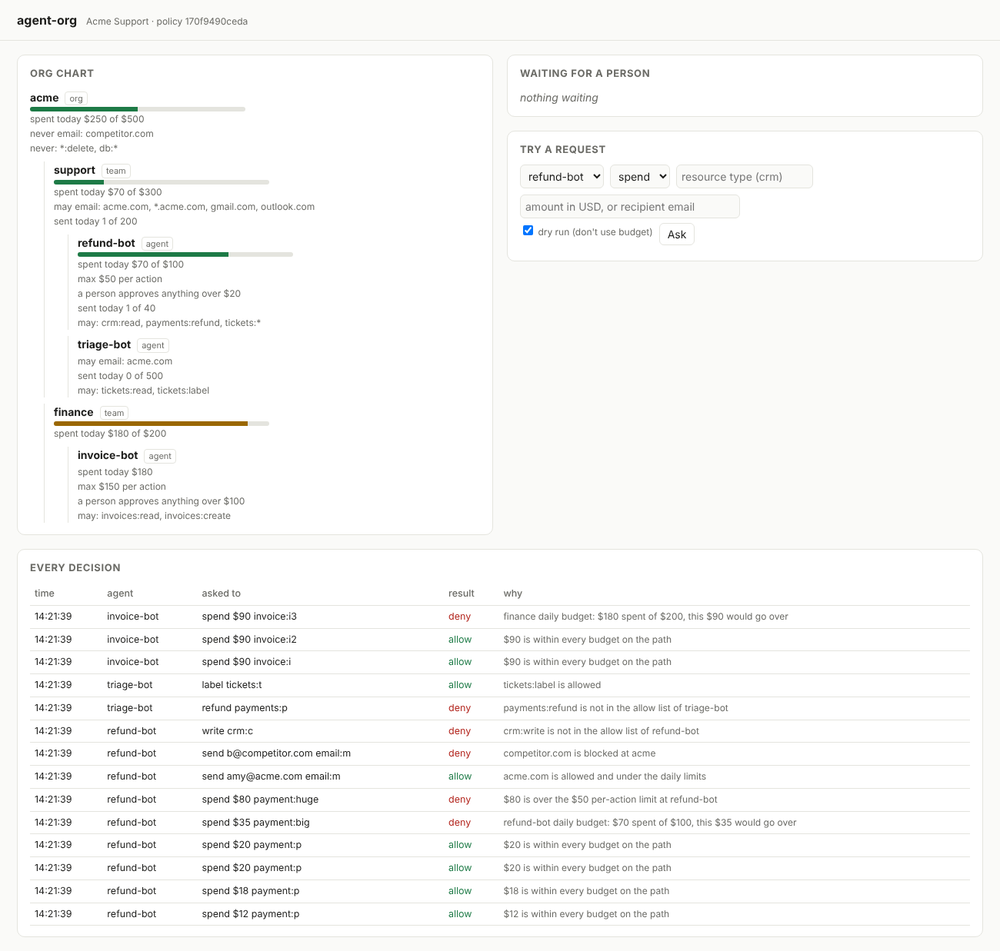

# agent-org

**An org chart for software: decide what each AI agent may spend, send and access.**



Agents sit in a tree (org > team > agent). You set limits on any node. A child can only be stricter than its parents, and a team's budget counts what *all* its agents spent. Anything over a threshold waits for a person, and a person's yes works once, for that exact request.

This is an early prototype (v0.1). It is a **decision point**, not a gateway: your agent asks "may I?" before it acts, and gets an answer and a reason. It has no dependencies except Python 3.9+.

```bash
git clone https://github.com/tarunagarwal1981/ops-ai && cd ops-ai/agent-org
python demo.py      # a scripted day: allows, denies, an approval, a shared budget
python server.py    # the control panel; open the URL it prints
```

## Ask it from any agent

It speaks the shape of the [OpenID AuthZEN](https://openid.net/wg/authzen/) access-evaluation API, so any language can call it:

```bash
curl -s localhost:8787/access/v1/evaluation -d '{
  "subject":  {"type": "agent", "id": "refund-bot"},
  "action":   {"name": "spend"},
  "resource": {"type": "payment", "id": "pay_123", "properties": {"amount_usd": 35}}
}'
# {"decision": false, "context": {"status": "needs_approval", "reason": "$35 is over the $20 approval
#   threshold at refund-bot", "approval_id": "apr_...", "policy_version": "170f9490ceda"}}
```

Or from Python, with `client.py` (one file, no dependencies):

```python
org = AgentOrg("http://127.0.0.1:8787", agent="refund-bot")

@org.guard("spend", "payment", amount_arg="amount")   # raises Denied or NeedsApproval
def issue_refund(payment_id, amount): ...
```

Three kinds of request:

| `action.name` | What it checks | Needs in `resource.properties` |
|---|---|---|
| `spend` | per-action, daily, monthly budgets (shared up the tree), approval threshold | `amount_usd` |
| `send` | allowed and blocked domains, messages per day | `recipient` |
| anything else (`read`, `write`, `refund`, ...) | allow and deny patterns on `<resource.type>:<action>` | none |

## The rules

- **Deny wins, and anything not clearly allowed is denied.** No budget set means no spend. No allow list means no access.
- **Fails closed.** A malformed request, an unknown agent, or an internal error is a deny. If the client can't reach the server, nothing is allowed.
- **The tree only narrows.** An agent can't be given more than its team, or its team more than the org.
- **Approvals are tied to the request.** Approving "$35 to payment p2" doesn't cover $36, or p3, or another agent. It works once.
- **Every decision is logged** with the rule that decided it and the policy version.
- **Dry run** (`"context": {"dry_run": true}`) answers without using budget or creating an approval.

Policy is one JSON file ([`org.example.json`](org.example.json)).

## Limits of this prototype (please read)

- **It only works if the agent asks.** Nothing here stops an agent that doesn't call it. For real enforcement, put the check where the agent can't skip it: in the tool server, the gateway, or the payment API. The lock-versus-request idea is explained in [`claude-code-hooks`](../claude-code-hooks).
- **Identity is trusted unless you set a key.** Without `api_key_sha256` on an agent, anyone who can reach the server can claim to be that agent. Set keys for any agent that matters.
- **The panel is local.** It binds to `127.0.0.1` and the admin API needs a token that agents don't get. Don't expose it to a network without proper login in front.
- **One process, SQLite, no high availability.** Fine for trying it out, not for production.
- **Spend is what the agent reports.** The server trusts `amount_usd`; it does not check the real bill.
- **A day is a UTC day.** Budgets reset at 00:00 UTC.

## What's next

An MCP wrapper that sits in front of tool servers; Cedar and OPA as backends behind the same endpoint; per-agent keys managed from the panel; login for the panel; alerts when a budget is nearly spent. Ideas and issues welcome.

## Tests

```bash
python test_agent_org.py   # 91 checks, including an HTTP round trip
```

If it's useful, a star on the repo helps other people find it.
